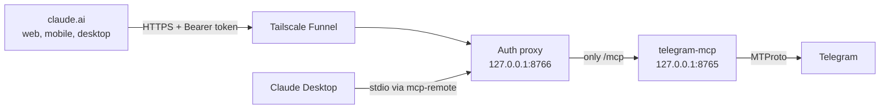

As software engineers, we have spent the last couple of years teaching AI assistants to read our code, our documents and our inboxes. Yet one of the places where a big part of my life actually happens remained completely out of reach: Telegram. Family groups, friends scattered across three continents, a few communities I follow, and more unread messages than I would like to admit.

A few months ago I wrote about [bridging local AI with Telegram](/articles/2026-04-09_bridging-the-gap-local-ai-meets-telegram-cli/), where a Telegram bot acted as a remote control for my local models. This time I wanted the opposite direction. Instead of using Telegram to talk to an AI, I wanted the AI to be able to look into my Telegram: "summarise what I missed in the family group this week", "find the message where someone sent me that address", "reply to that last message saying I will be there at eight". And I wanted that to work from claude.ai on the web, on my phone and on the desktop app.

The tool for this is the **Model Context Protocol (MCP)**: Claude connects to an MCP server, discovers the tools it offers, and calls them when needed. The interesting part is not the protocol itself, but everything around it. Giving an AI access to your personal messenger is not something you want to do casually.

#### A User Account, Not a Bot

The first decision was the most important one. Telegram has two very different APIs. The Bot API is the one most people know: you create a bot with BotFather and it can only see messages that are explicitly sent to it. That is useless for my purpose. A bot cannot read your conversations, because it is not you.

The alternative is **MTProto**, the protocol the official Telegram apps use. With a library like [Telethon](https://github.com/LonamiWebs/Telethon), your program logs in as *your user*, exactly like a new device would. It sees what you see and can do what you can do. That is precisely the power I wanted, and precisely why the rest of this article is mostly about limiting it.

There are a few open source MCP servers built on top of Telethon. I evaluated two of them and went with [chigwell/telegram-mcp](https://github.com/chigwell/telegram-mcp). The reasoning was not very sophisticated, but I think it is the right heuristic for anything that will hold credentials to my account: around two thousand stars, more than eighty contributors, and releases almost every week. The alternative was a well-written project with a handful of stars and two contributors. When something has access to every private conversation I have, I want many eyes on the code and a maintainer who is clearly still around.

#### The Architecture

The server runs on a Mac mini at home that is always on. The challenge is that claude.ai lives on the internet, while my Mac mini lives behind my router, and I had no intention of opening ports.



I was already using Tailscale for my own devices, and **Tailscale Funnel** solves exactly this problem: it publishes a single local port on a public `https://your-machine.your-tailnet.ts.net` address, with a valid TLS certificate, without touching the router. Funnel only points to one port, and that port is not the MCP server itself.

#### The Missing Piece: Authentication

The MCP server speaks *streamable HTTP*, the modern MCP transport, out of the box. What it does not have is any form of authentication. That is reasonable for a server designed to be consumed from localhost, but it is unacceptable once you put it on the internet. An unauthenticated endpoint that can read and send messages as me is, effectively, my Telegram account published to the world.

So the internal server only listens on `127.0.0.1`, and in front of it sits a small reverse proxy of about a hundred lines of Python. It does very few things, which is exactly the point:

*   It requires an `Authorization: Bearer <token>` header with a long random token, compared in constant time.
*   It forwards only the `/mcp` path. Everything else, authorised or not, returns an error.
*   Any request without a valid token gets a `401`, before anything reaches the Telegram process.
*   It does not write access logs with full paths, so a secret never ends up in a log file.

There was an interesting wrinkle with claude.ai. Custom connectors support OAuth, or no authentication at all, and more recently a **Request headers** option where you can attach a fixed `Authorization` header. That option is still rolling out, so I also made the proxy accept the token as part of the path (`/t/<token>/mcp`) as a fallback for clients that cannot send headers. It is the weaker option, since a URL tends to leak into places a header does not, but it is a pragmatic escape hatch. In my case the header option was available, so that is what I use.

Within minutes of enabling Funnel, my proxy logs showed requests from addresses I did not recognise. New TLS certificates are published in public Certificate Transparency logs, and scanners watch those logs constantly. Every single one of those requests got a `401`. It is a good reminder that "nobody knows my URL" is never a security model.

#### Least Privilege, With a Kill Switch

The Telegram MCP server exposes almost 150 tools: deleting messages, leaving groups, editing contacts, changing profile photos, managing admins. I do not want an AI agent to have any of those. Fortunately, the server has a well-designed mechanism to filter which tools are exposed, based on the MCP `readOnlyHint` annotations.

I configured it as *read-only plus two explicit write tools*: `send_message` and `reply_to_message`. Claude can list chats, read history and search, and it can write messages, but it cannot delete anything or leave a group, because those tools simply do not exist from its point of view.

On top of that, sending is controlled by a single environment variable. A small control script flips it and restarts the service:

```bash
ctl.sh send off   # read-only: 65 tools
ctl.sh send on    # read + send: 67 tools
```

The ability to downgrade an agent to read-only in two seconds, without touching any client configuration, is something I would now consider mandatory for any integration that can act on my behalf.

#### The Session File Is the Account

With MTProto, logging in produces a session file. It is worth stating plainly: **whoever has that file is you**. It does not expire after a few hours like an OAuth token, and it does not need your password or your phone again. So the session, the API credentials and the bearer token all live in a dedicated directory outside any repository, with `600` permissions, readable only by my user.

The configuration itself, meaning the proxy, the launch scripts and the service definitions, does live in a private Git repository, because infrastructure that is not versioned tends to rot. To make sure secrets never follow, the repository has a `.gitignore` for the obvious files and a pre-commit hook that reads the actual secret values from the local `.env` and blocks any commit that contains them. I tested it by deliberately trying to commit the token. It refused.

And then, of course, I leaked the token myself. While configuring the connector in claude.ai, I took a screenshot of the dialog to ask about a field, and the URL in it contained the token in the path. No hook can protect you from a screenshot. The fix took less than a minute: generate a new token, restart the proxy, verify that the old one returns `401`. The lesson is not "never make mistakes", but "make rotation so cheap that you do it the moment you doubt".

#### Making It Boring to Operate

A personal service is only useful if I can forget it exists. Both the MCP server and the proxy run as `launchd` agents with `KeepAlive`, so they start when I log in and restart automatically if they die. I tested it the impolite way, with a `kill -9`, and the service was back in a few seconds.

One subtle detail deserves a mention: Telegram does not like the same session being used from two places at once, and may invalidate it. The naive approach would be to let Claude Desktop launch its own local copy of the server, while the always-on copy serves claude.ai. Instead, Claude Desktop connects through `mcp-remote` to the very same local proxy. One process, one Telegram connection, many clients.

There were, as always, a couple of surprises along the way:

*   **The login code never arrived.** Telegram sends it inside the app rather than by SMS, and sometimes not at all. The server's own tooling supports QR login, where you scan a code from *Settings → Devices → Link Desktop Device* on your phone, so I wired that into my login script. No code needed.
*   **Testing the public URL from the Mac mini itself failed** with a certificate error. From inside the tailnet, the hostname resolves to the machine's private Tailscale address instead of the public Funnel endpoint. Forcing the request through the public IP showed that everything was working as intended.

#### Conclusions

*   A Telegram *user* account through MTProto is far more powerful than a bot, and therefore deserves far more care. Treat the session file like a password that never expires.
*   If a self-hosted MCP server does not have authentication, put an authenticating proxy in front of it. Never expose it directly, even behind an "obscure" URL. Scanners will find it in minutes.
*   Expose the minimum set of tools and keep a one-command switch to go read-only.
*   Version your configuration, but enforce that secrets cannot be committed, and make rotating them trivial.
*   Choose the server you depend on by the health of its community, not only by its features.

Being able to ask Claude, from my phone, what I missed in a group chat over the weekend feels like a small thing. But it is one of those small things that changes how you use a tool every day. Most of the work was not in connecting Claude to Telegram. It was in deciding what Claude should not be able to do.

I write my thoughts about Software Engineering and life in general on my [Mastodon account](https://kotlin.social/@eenriquelopez). If you have liked this article or if it did help you, feel free to share, 👏 it and/or leave a comment. This is the currency that fuels amateur writers.
